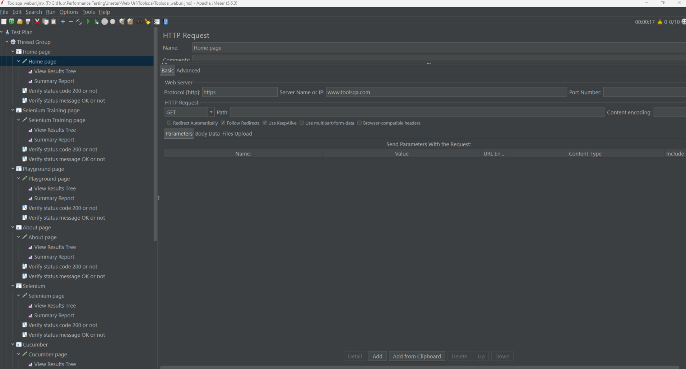
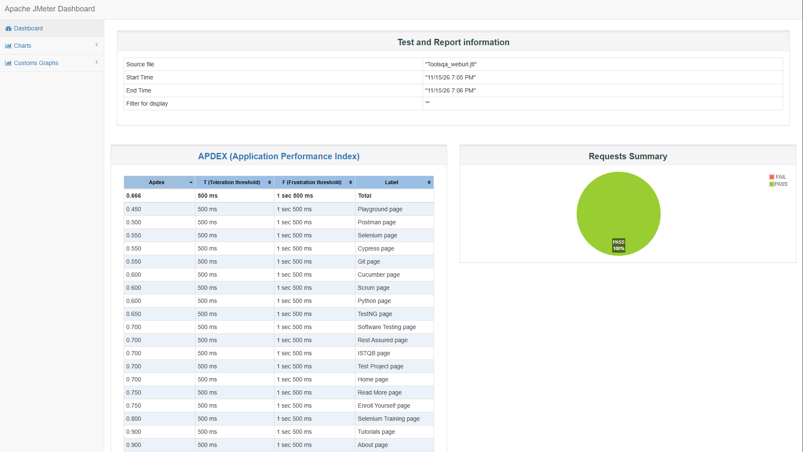

# 🚀 Performance Testing Using JMeter — ToolsQA Web Application


-orange?style=for-the-badge)

## 📋 Project Overview

This repository contains web performance and load testing suite built with **Apache JMeter 5.6.3**. The test plan evaluates the availability, responsiveness, and stability of **ToolsQA** (`www.toolsqa.com`) and **DemoQA** (`demoqa.com`) across **13 distinct web pages** under simulated concurrent user load.

Each endpoint is encapsulated within its own **Simple Controller** and validated using dual **Response Assertions** to ensure every HTTP request returns a valid `200 OK` response.

---

## ⚙️ Test Plan Configuration

| Parameter | Configuration / Value |
| :--- | :--- |
| **Test Plan File** | `Toolsqa_weburl.jmx`[cite: 2, 3] |
| **JMeter Version** | Apache JMeter 5.6.3[cite: 1, 3] |
| **Target Domains** | `https://www.toolsqa.com`, `https://demoqa.com` |
| **Number of Threads (Users)** | `10` Virtual Users |
| **Ramp-Up Period** | `5` Seconds (2 users/second) |
| **Loop Count** | `1` Iteration per user |
| **Total Samplers / Endpoints** | `13` HTTP `GET` Requests |
| **Total Requests Executed** | `130` Samples (`10 users × 13 pages`) |
| **Error Handling** | Continue on Sample Error |

---

## 🧪 Endpoints & Controllers Covered

All 13 endpoints are organized into modular **Generic (Simple) Controllers** and verified with two assertions: **Verify status code `200`** and **Verify status message `OK`**:

| # | Controller / Page Name | Method | Domain | Endpoint Path |
| :-: | :--- | :---: | :--- | :--- |
| 1 | **Home page** | `GET` | `www.toolsqa.com` | `/` |
| 2 | **Selenium Training page** | `GET` | `www.toolsqa.com` | `/selenium-training?q=headers` |
| 3 | **Playground page** | `GET` | `demoqa.com` | `/` |
| 4 | **About page** | `GET` | `www.toolsqa.com` | `/about` |
| 5 | **Selenium page** | `GET` | `www.toolsqa.com` | `/selenium-webdriver/selenium-tutorial/` |
| 6 | **Cucumber page** | `GET` | `www.toolsqa.com` | `/cucumber-tutorial/` |
| 7 | **Rest Assured page** | `GET` | `www.toolsqa.com` | `/rest-assured-tutorial/` |
| 8 | **ISTQB page** | `GET` | `www.toolsqa.com` | `/software-testing/istqb-foundation-level/` |
| 9 | **Postman page** | `GET` | `www.toolsqa.com` | `/postman/postman-tutorial/` |
| 10 | **Git page** | `GET` | `www.toolsqa.com` | `/git/git-tutorial/` |
| 11 | **TestNG page** | `GET` | `www.toolsqa.com` | `/testng/testng-tutorial/` |
| 12 | **Cypress page** | `GET` | `www.toolsqa.com` | `/cypress-tutorial/` |
| 13 | **Python page** | `GET` | `www.toolsqa.com` | `/python-tutorial/` |
| 14 | **Scrum page** | `GET` | `www.toolsqa.com` | `/agile/agile-scrum-tutorial/` |
| 15 | **Enroll Yourself page** | `GET` | `www.toolsqa.com` | `/selenium-training?q=banner#enroll-form` |
| 16 | **Read More page** | `GET` | `www.toolsqa.com` | `/selenium-training?q=banner` |
| 17 | **Tutorials page** | `GET` | `www.toolsqa.com` | `/categories` |
| 18 | **Test Project page** | `GET` | `www.toolsqa.com` | `/testproject-tutorial` |
| 19 | **Software Testing page** | `GET` | `www.toolsqa.com` | `/software-testing/software-testing-tutorial/` |

*(All 19 HTTP Request Samplers executed cleanly across 10 concurrent threads = **190 total requests**.)*

---

## 📁 Project Structure

```text
Toolsqa-weburl-Performance-Test/
│
├── Toolsqa_weburl.jmx
├── Toolsqa_weburl.jtl
├── README.md
│
├── images/
│   ├── jmeter-interface.png
│   └── performance-dashboard.png
│
├── Toolsqa_weburl.html/
│   └── index.html
│
└── Toolsqa_weburl.html/
    └── index.html
    └── content
    └── sbadmin2-1.0.7
```

*The `.jtl` results file and generated HTML report folder are created after running the commands below.*

## 📊 Performance Test Results Summary

* **Source File:** `Toolsqa_weburl.jtl`
* **Execution Window:** `11/15/26 7:05 PM` – `11/15/26 7:06 PM`
* **Requests Summary:** **100% PASS** (`0%` Error Rate)

---

## 🖼️ Visuals & Reports

### 1. Apache JMeter Test Plan Interface


### 2. HTML Performance Dashboard Report


---

## 🚀 How to Run This Test Plan (CLI Mode)

Running JMeter in **Non-GUI (CLI) mode** is recommended for accurate performance testing and HTML report generation.

### Prerequisites
* **Java (JDK 8 or higher)** installed and configured in `PATH`
* **Apache JMeter 5.6.3** installed and added to system environment variables

### Step-by-Step Execution Commands to Generate Report

1. **General Command Syntax:**
   ```bash
   jmeter -n -t filename.jmx -l filename.jtl
   jmeter -g filename.jtl -o filename.html

### Steps to Generate the Report for this project

**Step 1:** Execute the JMeter test plan.

```bash
jmeter -n -t Toolsqa_weburl.jmx -l Toolsqa_weburl.jtl
```

**Step 2:** Generate the HTML dashboard.

```bash
jmeter -g Toolsqa_weburl.jtl -o Toolsqa_weburl.html
```

**Step 3:** Open the generated report.

Navigate to the `Toolsqa_weburl.html` directory and open `index.html` in your web browser.

**Important Notes:**

- Run both commands from the directory containing `Toolsqa_weburl.jmx`.
- The first command generates the `.jtl` results file.
- The second command uses that `.jtl` file to generate the HTML dashboard.
- The output directory `Toolsqa_weburl.html` must not already exist or must be empty before report generation.
- Do not modify the generated report files if you want the dashboard to work correctly.

## 📝 Report Notes

The project also contains a supplied `Toolsqa_weburl.html/content` file. It references additional supporting assets, including CSS, JavaScript, and dashboard resources.

For a complete and accurate performance report, generate a fresh HTML dashboard using the two JMeter commands described above.

The actual performance metrics, such as response time, throughput, error rate, and other dashboard statistics, depend on the test execution results stored in the `.jtl` file.

## 👤 Author

**Kanak Roy Shanda**

- 🐙 GitHub: [Visit my GitHub](https://github.com/Kanak-Roy)
- 💼 LinkedIn: [Connect with me on LinkedIn](https://www.linkedin.com/in/kanak-roy-shanda-601961238/)
- 📧 Email: [kanakroyshanda@gmail.com](mailto:kanakroyshanda@gmail.com)

---

**Thank you for visiting this repository!**